# Moppe

**A small open world to walk, ride, fly, fish, and camp in, grown from its geology.**

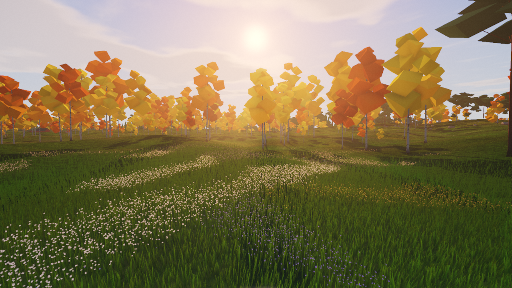

Moppe is two things at once. First, it is a quiet outdoor sandbox that my kids
and I like to wander around in — a place where it is fun to have coding agents
build a friend's motorcycle, a homemade cargo bike, a plywood skiff, or a
helicopter that can pick up a tractor on a cable. It is not trying to be
Skyrim; there are no quests or enemies, just a piece of northern country to
explore at your own pace.

At the same time, it is a workshop for exploring ideas in simulation,
real-time graphics, and software structure: landscapes and ecosystems that
grow out of natural history rather than hand-painted zones, compile-time
physical units, typed structure-of-arrays field bundles, a single Lisp shader
codebase targeting four GPU APIs, and the still-open problem of continuous
level of detail for procedural forests and ground flora.

You can **[play it in your browser](https://moppe.swa.sh)** (WebAssembly +
WebGPU; mirror at [mbrock.github.io/moppe](https://mbrock.github.io/moppe/)),
or download a native build for macOS, Linux / Steam Deck, or Windows from
**[GitHub Releases](https://github.com/mbrock/moppe/releases/latest)**.

---

## A walk around the world

<p align="center">
  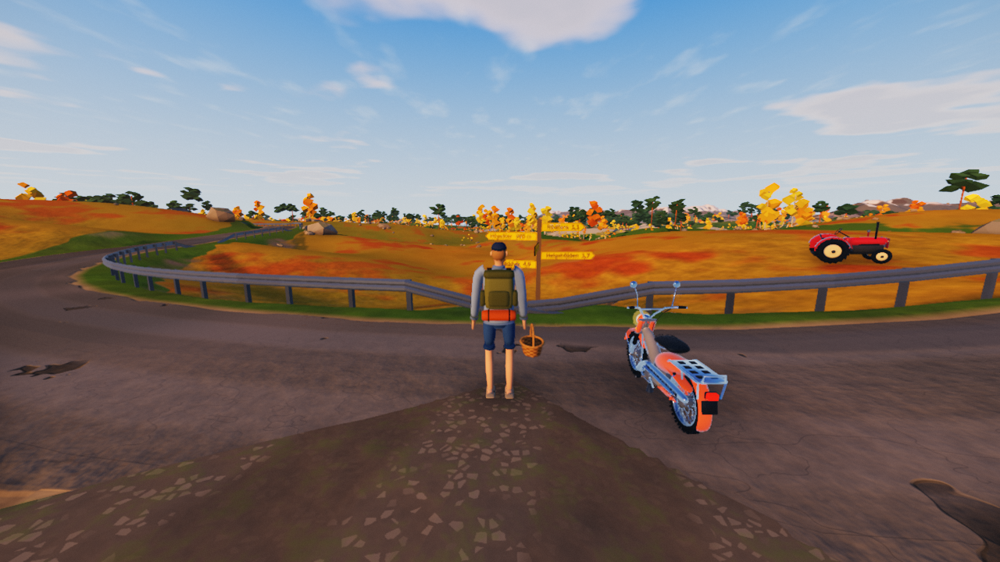
  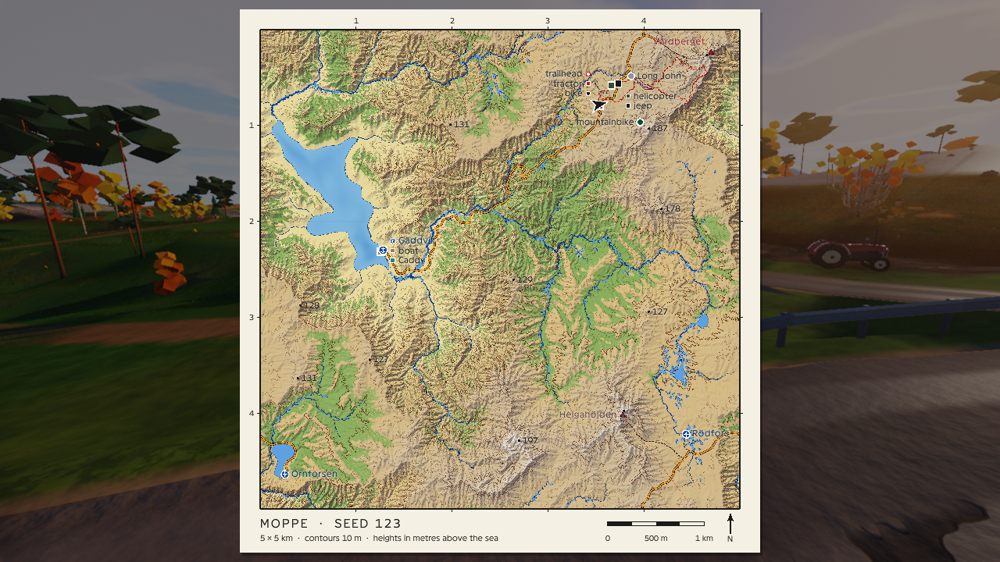
</p>

You start on an autumn morning at 60°N, standing beside a parked **1972 Honda
CT90 Trail 90**. Pressing `M` unfolds a paper relief map of the five-kilometre
world: shaded hills, ten-metre brown contours, rivers and lakes, and a small
network of cart roads and footpaths linking named Swedish places. At the road
junctions stand yellow and brown *vägvisare* fingerposts pointing the way to
the coastal landing, the old lake-outlet mills, and the stone sanctuaries up
on the fells.

<p align="center">
  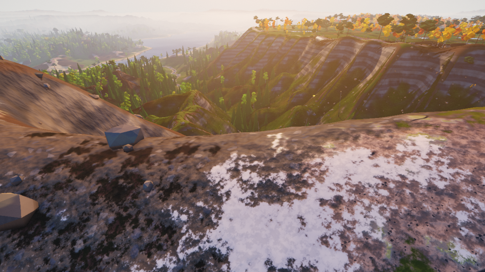
  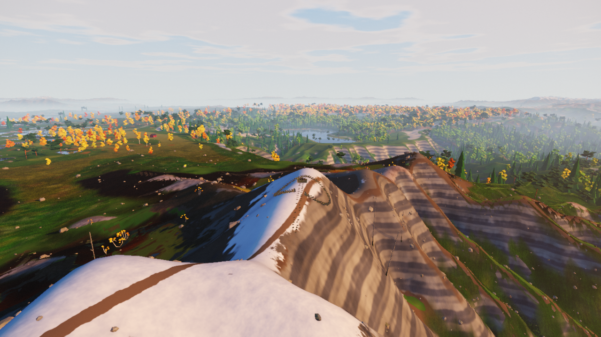
</p>

Scattered around the map are machines you can walk up to and take (`F`).
Several are modelled after real ones belonging to our friend Krisjanis, who
is also the rigged hiker you play as: his candy-orange Trail 90 (with jump
jets added under the frame), his welded red-and-steel Long John cargo bike
parked outside a farmhouse, and his 3.93 m birch-plywood skiff with a Honda
GX200 long-tail engine moored down at the jetty.

<p align="center">
  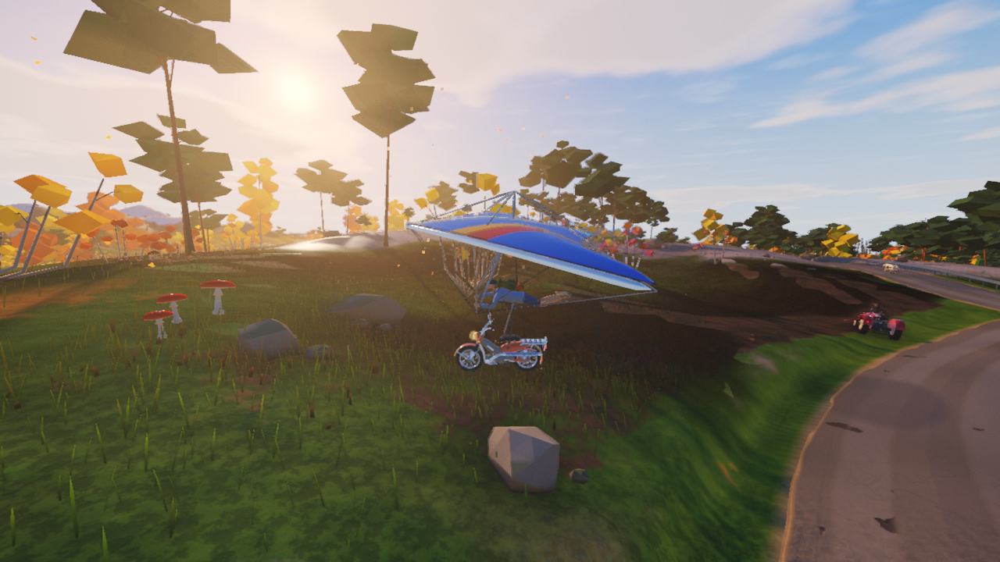
  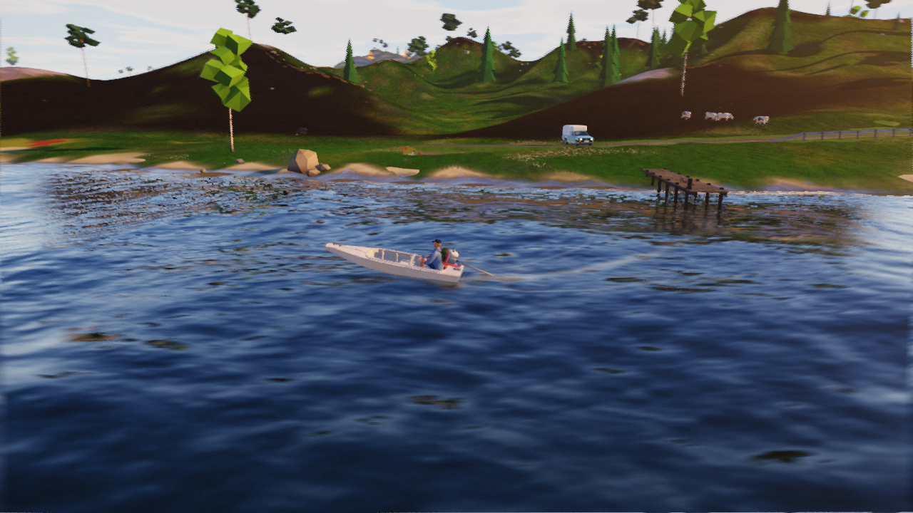
</p>
<p align="center">
  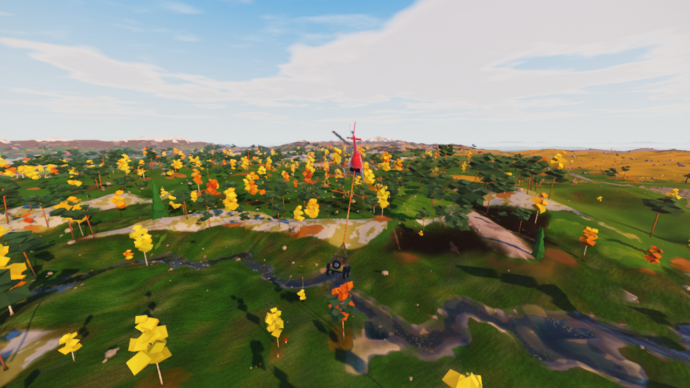
  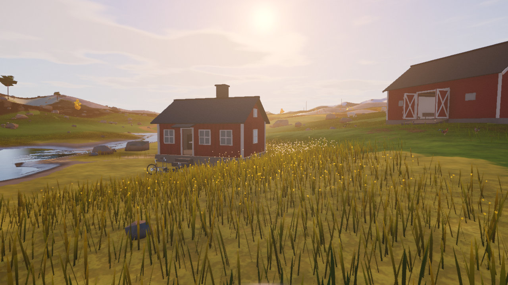
</p>

If you boost the Trail 90 into the air off a hill, you can deploy a hang
glider (`E`) with the motorcycle still tethered beneath the wing, diving for
speed and flaring with `Space` to land back on two wheels. There is also a
mountain bike up at the lookout, a vintage red tractor, a VW Caddy pickup by
the sea, an army jeep with a spare seat if a second player joins on the local
network (`--multiplayer`), and a helicopter that can hook any vehicle on a
sling line (`F`) and carry it across the valley.

<p align="center">
  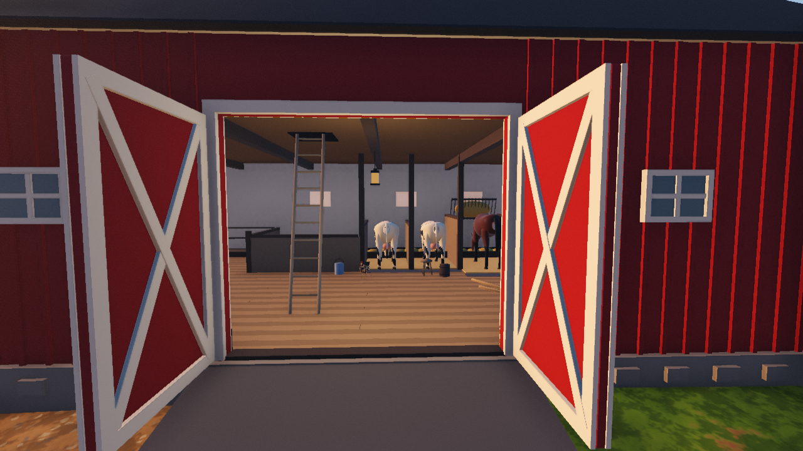
  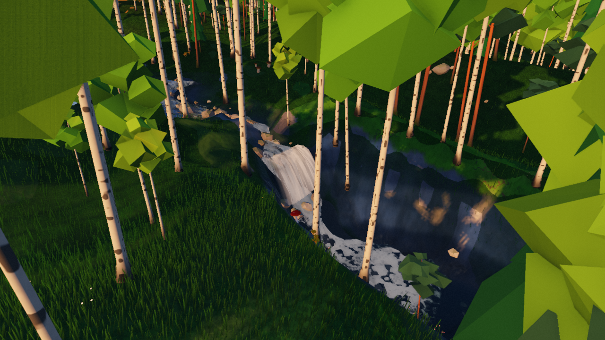
</p>
<p align="center">
  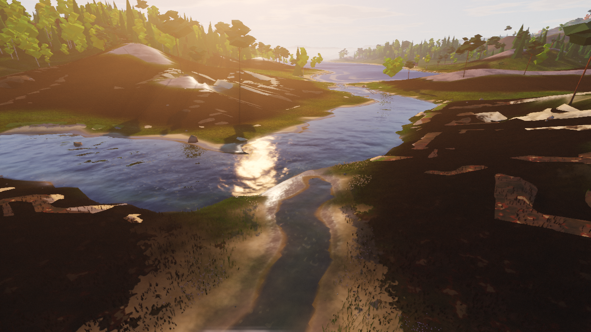
  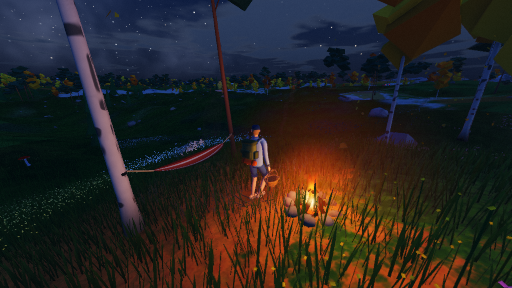
</p>

When you slow down, there are quieter things to do. You can walk through the
open doors of a Falu-red barn to see the horses, fjällkor, pigs, and chickens
inside, or gather eggs from the nest boxes on the wall. You can scan (`Q`) and
forage for chanterelles and porcini in the moss, or stand on a bank — or drift
in the skiff with the throttle shut — and cast a fishing float (`E`) for
trout, grayling, or perch. At dusk, `T` lights a campfire where `E` sets a
frying pan on the stones to cook what you found, and `R` between two birches
hangs a hammock where you can lie back and watch the stars turn while the
hours run fast until morning.

---

## What we are exploring

Beyond having a fun world to play in, Moppe is a testbed for a handful of
technical and architectural bets.

### Natural history instead of biome painting

Nothing in the world is placed by hand-painting biome masks. A world begins
with a seed and a `WorldRecipe` and runs through a causal sequence:

1. **Orogeny and erosion:** Tectonic uplift raises the crust for the first
   500,000 years while stream-power fluvial erosion, sediment transport, and
   hillslope creep run for two million ([`docs/what-age-does-to-this-world.md`](docs/what-age-does-to-this-world.md),
   [`docs/sediment-transport.md`](docs/sediment-transport.md)).
2. **Hydrology and channels:** Water pools into lakes behind sills and drains
   along a river network. Each river cuts a parabolic bed into its valley
   floor, laying gravel point bars on the inside of bends and steep cut banks
   on the outside ([`docs/land.md`](docs/land.md)), and scatters boulders and
   cobble riffles according to what its spate can move.
3. **Roads and places:** Cart roads and footpaths are graded into the slopes
   along least-cost routes between the trailhead, coastal landing, lake
   outlets, and high peaks ([`docs/trails.md`](docs/trails.md)), with timber
   watermills, farmsteads, and stone sanctuaries built where those ways end.
4. **Ecology and disturbance:** Site fields — soil water, soil depth, peat,
   cold, wind exposure, and a limestone sheet over crystalline granite
   basement (exposing scoured *hällmark* whalebacks on ridges and bright green
   spring fens where groundwater seeps out at the limestone's foot) — meet
   each species' tolerance curve. Spruce, Scots pine, birch, and low
   multi-stemmed fell birch compete for the canopy while heather, bilberry,
   lichen, and turf share the ground beneath. A final disturbance pass runs
   lightning fires through dry pine country (leaving standing grey snags and
   fireweed) and grazes pastures around lived-in farms and sanctuaries.

### Simulate in fields, experience in objects

To the simulation, a landscape is continuous fields over a periodic lattice:
elevation, moisture, sediment thickness, water velocity. To a player or a
camera, it is discrete things: a mountain, a confluence, a waterfall, a
bike. The codebase treats both honestly ([`docs/ontology.md`](docs/ontology.md))
and makes the projection from fields to named places explicit.

- **Physical units in the type system:** Every quantity specification is
  registered in [`moppe/quantities.hh`](moppe/quantities.hh) using `mp-units`
  ([`docs/units.md`](docs/units.md)). Heights are affine points in metres,
  thrust is in newtons, erosion rates are in metres per year, and the compiler
  refuses to add an airspeed to an altitude.
- **Typed field bundles:** `spatial::Bundle<Domain, Quantities...>` stores
  structure-of-arrays columns over a finite domain (`TerrainDomain`,
  `WaterBodyDomain`), indexed by quantity type rather than float-lane number
  ([`docs/surface-storage.md`](docs/surface-storage.md),
  [`docs/engine-atlas.md`](docs/engine-atlas.md)). Narrow analysis bundles
  compose into wider ones with `spatial::join` and serialize to Arrow IPC
  files with their unit and grid metadata intact.
- **Bit-identical worlds across platforms:** Generation code builds with
  `-ffp-contract=off` and calls correctly rounded `CORE-MATH` functions
  (`moppe::cr::`), then quantizes the resulting land onto exact power-of-two
  16-bit fixed-point grids ([`docs/determinism.md`](docs/determinism.md),
  [`docs/land.md`](docs/land.md)). Seed 123 produces the exact same world to
  the byte on an Apple Silicon Mac, an x86_64 Linux box, Windows, an Xbox,
  and WebAssembly in a browser.

Alongside the game live three small workshops — **Étalon** (`etalon/`, a Zig
quantity-and-bundle prototype), **Atelier** (`atelier/`, a Metal graphics
workshop; [`docs/atelier-earth.md`](docs/atelier-earth.md),
[`docs/atelier-tree.md`](docs/atelier-tree.md)), and **Lavoir** (`lavoir/`,
page-aligned Arrow buffers lent directly to Metal) — where we test mechanisms
in isolation before adopting them in Moppe.

### One portable renderer (NHAL) and shaders in Lisp

Moppe has a single renderer (`moppe/nhal/renderer/`, [`docs/nhal.md`](docs/nhal.md))
built on **NHAL** (`moppe/nhal/`), a small C++ hardware layer with four
backends: **Metal 4** on macOS, iOS, and tvOS; **Vulkan 1.3** on Linux and
Windows; **Direct3D 12** on Xbox Series X|S; and **WebGPU** in the browser
([`docs/web.md`](docs/web.md)).

All 36 shader programs live in one file,
[`moppe/nhal/renderer/shaders/world.lisp`](moppe/nhal/renderer/shaders/world.lisp),
written in Luv's mathematical Lisp shader language and lowered ahead of time
by `luv-shaderc` into MSL, HLSL, SPIR-V, and WGSL. Even the text — both the
HUD and the lettering on wooden fingerposts in the 3D world — is rendered
straight from quadratic TrueType outlines in the fragment shader via the Slug
algorithm.

### Procedural flora and the level-of-detail problem

No tree or grass mesh is stored in memory or on disk. Every frame, a compute
pass culls the world's ~190,000 trees into `(species, detail tier)` classes
and vertex-pulls their trunks, branches, and leaf clumps from per-tree seeds,
while the undergrowth pass evaluates grass blades, heather cushions, and
meadow flowers directly from the surface readings.

Getting a procedural forest and sward to hold together across distance — from
individual trunks and blades near the camera out to a continuous canopy on a
far hillside, without popping, thinning, or shimmering in motion — is one of
the hardest and most interesting open problems in the project. Our notes in
[`docs/forest-lod.md`](docs/forest-lod.md),
[`docs/forest-density-and-aggregates.md`](docs/forest-density-and-aggregates.md),
and [`docs/ensemble-continuity.md`](docs/ensemble-continuity.md) frame level
of detail as a renormalization tower: each coarser representation is a change
of theory that must match the conserved moments (mean colour, optical
coverage, texture variance, and wind motion) of the finer one. Parts of that
handoff work well today, and parts are still very much under construction.

---

## Controls at a glance

`W`/`A`/`S`/`D`, `E`, and `F` use physical QWERTY positions on every keyboard
layout (so Dvorak and Colemak work out of the box). Gamepads (Xbox,
PlayStation, MFi) use the left stick to move/steer, right stick to look, `B`
to mount/dismount, `A` to jump/interact, `X` for camera, and shoulders for
hammock and fire.

- **Move & look:** `W` `A` `S` `D` and mouse (`L` releases the cursor; `Tab`
  cycles chase, front, and first-person views).
- **Jump, boost, flare, or climb:** `Space` (`Shift` runs on foot, skids the
  rear wheel on bikes, and descends in the helicopter).
- **Mount, dismount, tow, or sling-hook:** `F` near any bike, car, boat,
  helicopter, or stuck vehicle.
- **Interact (`E`):** deploy the hang glider while airborne; pick mushrooms or
  eggs; cast or strike a fishing line; fry and eat supper by a fire; lie down
  in a hammock.
- **Camp & navigate:** `R` hangs a hammock between two trees (or leans back for
  a wheelie on the Trail 90); `T` lights a campfire or sanctuary beacon; `Q`
  scans nearby mushrooms and hammock trees; `M` unfolds the map; `P` saves a
  screenshot and `V` records a video clip.

---

## Build and run

On **macOS**, install Xcode's command-line tools, CMake 3.24+, and Ninja. On
**Linux**, run `nix develop` to enter the flake's shell (Clang 21, CMake,
Ninja, SDL3, Vulkan, `luv-shaderc`, `ffmpeg`).

```sh
cmake -B build -G Ninja -DCMAKE_BUILD_TYPE=RelWithDebInfo
cmake --build build --target moppe

# Optional: download the pre-baked default land so first launch takes seconds
./tools/fetch-land

# Run (macOS / Linux)
./build/moppe.app/Contents/MacOS/moppe
./build/moppe
```

A few useful ways to run it:

```sh
./build/moppe --windowed --seed 123
./build/moppe --multiplayer
MOPPE_CLOCK=21.5 MOPPE_WEATHER=clear ./build/moppe --windowed
./tools/record /tmp/camp.mp4 camp
```

Other targets and checks:

- **Browser (WebGPU):** `make web-serve` builds with Emscripten and serves at
  <http://localhost:8080> ([`docs/web.md`](docs/web.md)); `make site` builds
  the interactive landing page ([`docs/site.md`](docs/site.md)).
- **Steam Deck & Windows:** `nix build .#moppe-steamdeck`
  ([`docs/steam-deck.md`](docs/steam-deck.md)) and `nix build .#moppe-windows`.
- **iPhone, Apple TV, and Xbox:** `make phone`, `make tv`, and `make xbox`
  ([`docs/nhal.md`](docs/nhal.md)).
- **Tests:** `make test` runs the C++ test suite; `make etalon-test` runs
  Étalon's Zig tests.

For the full map of documentation, see [`docs/README.md`](docs/README.md) and
[`AGENTS.md`](AGENTS.md).
