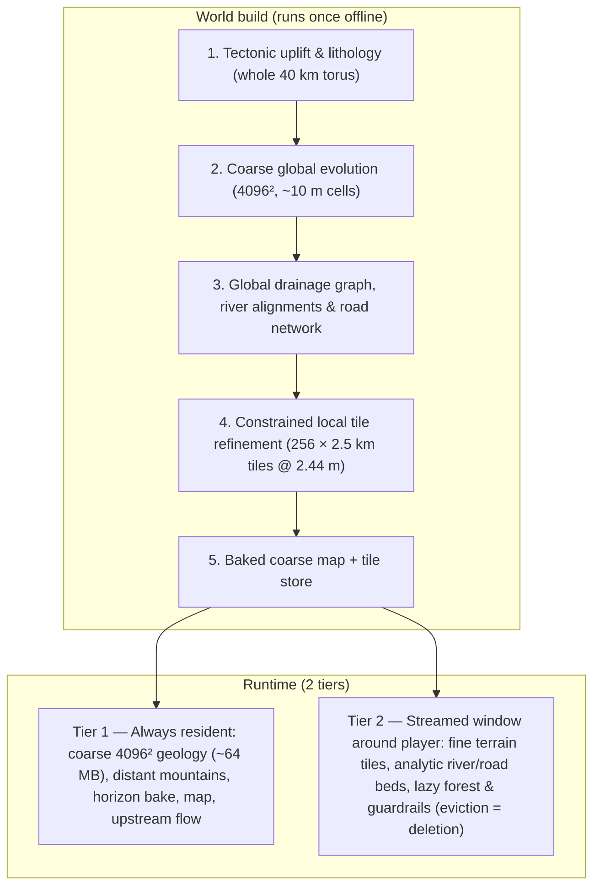

# Moppe: toward a very large world

Nov 26, 2026 · @Mikael Brockman

## Summary

Grow the world from 10 km to about 40 km a side by solving geology coarsely for
the whole torus, refining it in tiles, and streaming the result. Rivers and
mountains each need roughly that size, by separate arguments.

Decisions already taken:

- **One chosen world.** Try seeds, pick the best, and make that one good. The
  `N` key for a fresh world goes away.
- **The world is a given.** Riders don't dig. Anything built later is a feature
  added on top, not an edit to the ground.
- **The torus stays.** Closed, flat, no edges, no off-map hinterland.
- **Refine, never extend.** No land is invented at a frontier. Detail is added
  to land that already exists.
- **No noise for its own sake.** Fine detail must be caused by its surroundings.

Numbers marked *measured* come from the repo. The rest are estimates scaled from
them, or figures from memory, and are marked as such.

## Where the world stands

The world is 10 km a side on a 4096² grid, so 2.44 m between samples. All
figures here are measured, from [orogeny-performance.md](orogeny-performance.md)
and [world-memory.md](world-memory.md), on a 16 GiB M2 Pro with seed 123.

| Measure | Value |
| --- | --- |
| Erosion, CPU reference | 1,424 s |
| Erosion, Metal | 7.08 s (about 200× faster) |
| Cold start to first playable frame | 75.5 s |
| Physical memory footprint (cold start peak / cached load peak / steady play) | 10.22 / 5.49 / 1.68 GiB |
| Elevation, 10th / 50th / 99th percentile | 105 / 163 / 223 m |
| Median relief inside a 625 m square | 59 m |
| Largest river basin | 57 km² of the 100 km² world |
| Evolution | 40 steps of 50,000 years, uplift for the first 500,000 |

Three things follow from these:

- **Time is no longer the constraint.** Erosion is 7 of the 75 seconds. Roads,
  vegetation, guardrails and cache writing are the rest.
- **Memory is the constraint.** Even after steady-play optimizations, the GPU
  and runtime hold full-resolution heights, normals, material channels and
  whole-world forest records for the entire map; scaling area 16× without
  streaming breaks a 16 GiB machine.
- **GPU and CPU make slightly different worlds.** Largest basin agrees (57.03
  against 57.09 km²), but coastal river mouths were 13 against 15.

## Why bigger

A 10 km torus with 200 m of relief can hold streams and hills, and physically
cannot hold a navigable river or a mountain. Both need about 40 km.

### Rivers

Three rules of thumb do the work. Flow is catchment area times runoff, about
0.02 to 0.03 m³/s per km² in a wet Nordic climate. Width grows with about the
square root of flow. Gradient falls as catchment grows. The table assumes the
main river drains half the world, as it does today. All values are estimates.

| World side | Area | Main catchment | Flow at the mouth | What it is |
| --- | --- | --- | --- | --- |
| 10 km | 100 km² | 50 km² | 1 to 2 m³/s | brook, ankle deep |
| 20 km | 400 km² | 200 km² | about 5 m³/s | stream, canoe in places |
| 40 km | 1,600 km² | 800 km² | about 20 m³/s | small river, skiff on lower reaches |
| 80 km | 6,400 km² | 3,200 km² | about 80 m³/s | proper river, 50 m wide |

Gradient is the second problem. Today the land falls about 200 m in under 10 km,
near 2%. Navigable rivers fall well under 0.1%. For scale, from memory: the
Gauja drains roughly 9,000 km² and is a canoeing river.

For comparison, GTA 5 is about 80 km² and GTA 6 about 160 km² by community
estimate, so the present world is already in that range.

### Mountains

Three things make today's mountains read as hills:

- **Relief is hill-sized.** Nearly all land sits in a 120 m band. From memory,
  Åreskutan stands about 1,000 m over its lake on a base 8 to 10 km wide.
- **Relief is all short-range.** Half of the world's total relief appears inside
  any 625 m square. The terrain is finely crumpled, with no large mass under the
  detail.
- **The cues disagree with the size.** Snow caps and a tree line sit on a 220 m
  rise. A flat torus also has no horizon, so haze is the only distance cue, and
  10 km gives it little room.

Keeping relief near today's while growing the map lowers gradients, which helps
rivers. Mountains need the opposite locally: one broad massif with 1,000 m or
more.

## Architecture

Solve the whole world coarsely, refine it tile by tile, and keep only the tiles
near the player at full detail.

Everything in the upper band runs once, when the world is made. The game keeps
the coarse world whole and streams fine tiles around the player.

### Why the split is legitimate

Landscapes have two regimes. Channels are global: a river's course and size
depend on everything upstream, so they must be solved for the whole torus at
once. Hillslopes are local: ground between channels sheds soil and water over
tens to a few hundred metres, and depends only on its neighbourhood and the
channel at its foot.

A grid near 10 m sits at that boundary. A 40 km world on 4096² is 9.8 m per cell
and costs the same seven seconds as today.

### The layered surface

The ground becomes one function, evaluated anywhere, that rendering and physics
both call:

1. **Geology.** The coarse grid, interpolated bicubically so cell edges leave no
   creases.
2. **Analytic features.** River and road beds as cross-section profiles around
   their splines, added on top and never stamped into the grid.
3. **Grit.** Fine detail driven by slope, moisture, flow direction and material.

This gives the skiff a real river bed without raster carving, which
[RFC-006](../plan/rfc-006-analytic-channels.md) had already removed in July and
which came back on 24 November.

### Tile refinement

A tile runs a short fine-resolution settle, driven by the coarse solution.
Rivers enter at the tile edge already carrying their upstream water.

- **The honesty rule.** Averaging a fine tile back down must return the coarse
  cells exactly. Detail may vary around the coarse surface and may never move
  it. This also makes the distant and close views the same land.
- **Seams.** Tile edges are pinned to the coarse surface, so neighbours agree by
  construction.
- **Not more geological time.** The multigrid run that continued full evolution
  at finer levels raised local relief by 50%. Refinement is a short constrained
  settle.
- **Memory.** A 2.5 km tile at 2.44 m is about a million cells whatever the
  world size.

### Bake, then stream

Baking is the same refinement run over every tile once. A 40 km world is 256
tiles; at about a second each, estimated from the measured solver speed, that is
minutes on one Mac. With one chosen world, on-demand refinement becomes optional
and the game only streams.

- **Always loaded:** coarse geology for the whole world, about 64 MB for a
  4096² height grid. Distant mountains, the horizon bake, the map and upstream
  water all need it.
- **Resident window:** fine terrain, vegetation, road and river meshes, and
  physics for tiles near the player.
- **Lazy steps:** forest planting and guardrails run per tile on arrival. Only
  truly global planning, such as road routing, stays up front.
- **Eviction is deletion.** Tiles hold nothing the player did, so there is
  nothing to save.

## Geology changes

The simulated part of the geology is 677 lines (`stream_power_evolution.cc`) and
the hand-sculpted part is 2,889 (`glacial.cc` + `channel.cc`). Most fixes below
move work from sculpting back into process, or replace intervention with
selection.

### The ravines

The likely cause is the glacial sculptor forcing a lowland river's profile into
a mountain island. It grades its trough floor at 0.26% near the coast and 0.78%
inland, while the natural valley rises about four times faster. Five kilometres
inland that difference is a trench of 60 m or more. This is inferred from the
parameters in `moppe/terrain/glacial.hh`, and not yet confirmed against a
screenshot.

- **Settle after every intervention.** Carve, then run the hillslope process
  alone near the changed cells until slopes are stable. Order: geology, then
  rivers, then people, each followed by a settle.
- **Built things as boundary conditions.** A road is a set of fixed cells that
  neighbours read and never overwrite.
- **Earthworks on the books.** Cut must balance fill. This is a first real use
  for `moppe/pacioli.hh`.

### Three levers for getting the world you want

1. **Fine-tune the causes.** Shape the uplift map so a trunk valley and a massif
   are likely.
2. **Select among worlds.** Generate many coarse worlds in seconds and keep one
   that passes a test.
3. **Intervene.** Carve only what is still missing.

Use them in that order. A selected seed must be re-checked on the bake that will
actually ship.

### Navigable water without forcing a river

- **Drowned valleys.** Raise the sea relative to the land so it floods up the
  trunk valley as a fjord. One parameter, no carving.
- **Lake chains.** Glacial basins joined by short rapids. Boat the lakes and
  portage the rapids.
- **Waterworks.** Locks, weirs and canal cuts, made by the world's people as
  roads are.
- **The rain dial.** A quiet multiplier on runoff, so the same catchment carries
  more water. (Note: `moppe/terrain/river.cc` already uses a bankfull spate
  runoff of 2.5 m³/s per km², roughly 100× mean Nordic runoff, so growing to
  40 km allows dialing this back toward physical honesty.)

### Ice as a process

Hergarten (2021) gives a glacial erosion law shaped like the stream-power law
already in the solver. It produces overdeepened basins, hanging valleys and
confluence steps, three things the sculptor now draws by hand. It would be a
second erosion law in the same loop, active above a snowline in cold periods.

### Mountain mass

- Give the uplift map one broad dome several kilometres across.
- Lengthen the hillslope scale so valleys sit about a kilometre apart.
- A coarser grid may help by itself, since it cannot form valleys closer than a
  few cells.

### Gaps in rivers

In `moppe/terrain/drainage.cc`, reach topology already uses single-path D8
(`drainage.contributing_area_at`), but `extract_river_network` then supplies
D-infinity `fractional_contributing_area` to `build_river_alignments`, which can
spread on flat valley floors and starve painted discharge/width mid-course.
Verify against captures and route channel discharge down a single path where
needed.

## Experiments, in order

The first two cost almost nothing and decide whether the rest is worth doing.
Each later one depends on those above it.

| # | Experiment | What to do | What counts as a pass |
| --- | --- | --- | --- |
| 1 | Look at a big coarse world | Set extent to 20 and 40 km at 4096² and fly the glider. Expect metre-tuned roads and channels to break. | Mountains read as masses and valleys as long. Note what 10 m cells look like up close. |
| 2 | Amplification against ground truth | Downsample today's 2.44 m world to 10 m, refine it back, compare with the original. | Slope distribution, relief in 625 m squares and river positions match the measures in the benchmark table. |
| 3 | Find the ravines | Screenshot one, then disable glacial sculpting and channel carving in turn. | The cause is named and reproducible from a seed. |
| 4 | Settle pass | Run hillslope relaxation near carved cells after each sculpting step. | No wall steeper than the stable angle. Mass change is accounted for. |
| 5 | Seed selection | Write the navigability test on the drainage graph, then roll a few hundred coarse seeds. | Some seeds pass with no carving. The chosen seed still passes on the shipping bake. |
| 6 | Layered surface | River beds as profiles around their splines, sampled by render and physics. Remove raster carving. | The skiff floats in a bed that exists at any sampling resolution. |
| 7 | Bounded memory | Terrain level of detail and per-tile vegetation on today's 10 km world. | Footprint stays flat as extent grows. Cold start falls. |
| 8 | Bake and stream | Bake all tiles of a 40 km world once, then stream from disk. | Seams are exact. A tile reloaded later is byte-identical. |
| 9 | Ice law | Add the glacial stream-power law above a snowline. | U-valleys and hanging valleys appear without the sculptor. |

Experiment 2 should stay in the repo as a regression check after it passes.

### Experiment 1 results (2026-11-26)

Ran 10, 20, and 40 km worlds at 4096² on Metal (16 GiB M2 Pro, seed 123, 40
steps of 50,000 years, `MOPPE_NO_SCULPT=1` for pure evolved geology) after
allowing `--world-size` up to 80 km, switching `geological.cc` past 10 km from
frequency-tiled 5 km waves to a macro tectonic mountain belt + antipodal sea
basin, scaling `lithology.cc` regional fold/fissure wavelengths with extent,
and easing fog / far-plane reach and temporary global forest/boulder pitch for
`> 10 km` worlds (leaving `<= 10 km` bit-identical).

| Measure (4096², seed 123, Metal) | 10 km | 20 km | 40 km |
| --- | ---: | ---: | ---: |
| Cell spacing | 2.44 m | 4.88 m | 9.77 m |
| Metal evolution time | 9.04 s | 8.24 s | 8.18 s |
| Dry land | 97.72% | 89.63% | 89.63% |
| Elevation p10 / p50 / p90 / p99 / max (sea 50 m) | 130 / 156 / 185 / 237 / 354 m | 61 / 112 / 252 / 896 / 1,126 m | 61 / 112 / 255 / 1,276 / 1,614 m |
| Median relief in 625 m squares | 62.9 m | 36.7 m | 20.2 m |
| Mean slope | 12.06° | 7.81° | 4.63° |
| Largest coastal basin | 73.1 km² | 289.7 km² | 1,153.5 km² |
| Main-stem river length | 25.8 km | 22.7 km | 46.8 km |
| Main-stem grade (full / lower half) | 0.45% / 0.77% | 0.78% / 0.12% | 0.38% / 0.10% |
| Cold start to play / cached load | 75.5 s / 17.4 s | 122.6 s / 14.1 s | 317.8 s / 22.2 s |
| Resident trees (scaled pitch) / Metal alloc | 1.17M / 1.06 GiB | 1.39M / 1.28 GiB | 2.11M / 1.65 GiB |
| Roads & bus loop | 18 places, 13.5 km loop | 38 places, 27.1 km loop | 62 places, 95.0 km loop (99 stops, 20 buses) |

What the captures and hillshades showed:

- **Scale & mountain mass (Pass):** Both 20 km (1,126 m peak) and 40 km
  (1,614 m peak) read immediately as monumental mountain masses rising out of
  atmospheric haze across 5–12 km of boreal plain and bays. Lower main-stem
  river gradients naturally drop to **0.10–0.12%** with zero carving, and the
  40 km main catchment reaches **1,154 km²** (46.8 km main stem).
- **Hillslope scale & ridge sharpness:** Raising `channel_initiation_area` too
  aggressively (162,000 m² at 40 km) melted summit ridges into smooth pillows,
  matching `stream_power_evolution.hh`'s warning; a modest threshold (8,000–24,000 m²)
  kept alpine ridges crisp while spacing mountain valleys. Without glacial
  erosion (Experiment 9), the broad dome still reads as a fluted volcanic/ice-cap
  shield rather than cirque-carved peaks, and `measure_climatic_relief` (93rd
  percentile / 0.68) placed the snowline low (~350 m above sea), blanketing
  almost the whole massif in snow.
- **What 4.88 m and 9.77 m cells look like up close:** In grassy meadows and
  autumn birch woods, even 9.77 m cells hold up surprisingly well at eye level
  with only subtle diagonal quad creases on shaded hillsides. They clearly
  break down on sharp features: ~10 m polygonal facets along shorelines and road
  banks, and visible diagonal grid stair-stepping inside narrow steep alpine
  gullies — confirming the need for bicubic geology + grit + fine local tile
  refinement near the camera.
- **What broke with metre-tuned systems (as expected):**
  1. `river.cc`'s 2.5 m³/s/km² spate runoff (tuned for 10 km brooks) floods
     gentle 0.10% uncarved 40 km valleys (including the 40 km trailhead), where
     discharge reaches thousands of m³/s.
  2. `relief_map.cc` strokes every reach above `visible_river_minimum_area()`
     (0.17 km²) at a fixed pixel pen width; at 40 km, 16× more streams saturate
     the paper map in dark river ink (20 km stays legible).
  3. Global road planning (62 places, 73 ways) and whole-world vegetation
     analysis drove 40 km cold start to 5.3 minutes even with 8.2 s orogeny,
     reinforcing that vegetation and local detail must move to lazy per-tile
     steps.

## Risks and checks

The main risk is not any single technique. It is that an agreed idea quietly
lapses while features are added, as units did: 64 units commits in July, one in
October, 79 in November.

| Risk | Why it matters | Check that fails when it lapses |
| --- | --- | --- |
| Whole-world arrays in game logic | Roads, places, animals and forest index one resident grid today. | A build check that flags game code touching a whole-world array. |
| Determinism | A reloaded tile, or the same tile on another peer, must match. Multiplayer was overhauled on 25 November, so this now crosses machines. | Hash each baked tile. Compare across runs and across CPU and GPU. |
| Fake detail | Refinement that ignores context gives noise. | Experiment 2 as a standing regression test. |
| Coarse and fine disagree | The far view and the near view would be different land. | Assert that averaging each fine tile returns the coarse cells. |
| Raster carving returns | It already came back once after RFC-006 removed it. | A test that no step after erosion writes heights into the grid. |
| Memory creeps back | The world outgrows a 16 GiB machine. | A footprint budget in the benchmark, enforced as a ratchet like `tools/units-report`. |
| The world is too big to enjoy | An 80 km world takes over an hour to cross by bike. | Keep today's world as a dense home valley inside the large one. Bus, teleport sheet and faster time cover the rest. |

Two scale limits to keep in mind. As far as we know, 16,384 is the largest
texture side on Apple GPUs, which is exactly 40 km at 2.44 m. And solving a
40 km world at full resolution in one piece would need about 43 GiB of GPU
memory, scaled from today's 2.7 GiB, which is why the coarse-plus-tiles route is
the one proposed here.

## Pointers

Most of this direction is already written down in the two repos, in pieces.
Paths are as of 25 November 2026.

### In moppe

| Where | What it holds for this work |
| --- | --- |
| `docs/orogeny-performance.md` | The measurements, and the multigrid warning |
| `docs/world-memory.md` | Where the memory goes |
| `ideas/insjo.md` | Domains, kinds, measure-preserving quotients between lattices, world = substrate × seed × journal |
| `ideas/by-derivation.md`, `ideas/by-fiat.md` | Deriving tiles from a seed; shared fiat boundaries so seams close exactly |
| `ideas/geometry-from-fields.md` | Grit and clutter generated from field textures |
| `ideas/rivers-first.md` | Drainage tree first, elevation derived from it |
| `plan/rfc-006-analytic-channels.md` | Rivers as continuous alignments, not raster carves |
| `plan/rfc-015-graphs-as-domains.md` | Typed index columns, for road and river graphs and for meshes |
| `docs/atelier-earth.md` | Universal cover rendering; the equal-area hexagonal commons that refines where relief is high |
| `moppe/terrain/stream_power_evolution.cc` | The process simulation |
| `moppe/terrain/glacial.cc`, `channel.cc` | The sculpting to shrink or replace |
| `moppe/pacioli.hh` | Double-entry accumulator, currently unused |
| `tools/units-report` | The model for a ratchet check |

### In luv

| Where | What it holds for this work |
| --- | --- |
| `luvcraft/terrain.lisp` | A resident window that materializes near the player and evicts the rest |
| `luvcraft/world.lisp` | Chunk domains, windows across chunk borders, border revisions |
| `wiki/domains-and-bundles.org` | The same domain and bundle model, reached separately |
| `frontiers/frontier.lisp` | Quantity-checked value laws compiled to loops: the seed of a shared kernel language |
| `wiki/luft-far-field.org` | How distant terrain should break down gracefully |

### Outside references

- Hergarten, [Modeling glacial and fluvial landform evolution at large scales using a stream-power approach](https://esurf.copernicus.org/articles/9/937/2021/), Earth Surface Dynamics, 2021. The glacial law.
- Liebl et al., [benchmark of the glacial stream-power law against iSOSIA](https://gmd.copernicus.org/articles/16/1315/2023/gmd-16-1315-2023.pdf), Geoscientific Model Development, 2023. Where the simple law falls short.
- GTA map sizes: [community estimates](https://allthings.how/gta-6-map-size-how-vice-city-and-leonida-compare-to-los-santos/). Rockstar has published ratios, not areas.
- From memory, not checked: Maxwell, "On Hills and Dales" (1870), for the count
  of peaks, passes and pits; Hack's law and Leopold and Maddock's hydraulic
  geometry for river scaling; "terrain amplification" as the search term for
  refining coarse terrain.

## Open questions

- [ ] **How big?** 40 km is where both arguments land. Experiment 1 should
  confirm or move it.
- [ ] **How much relief?** Today's 200 m spread gives gentle rivers. A massif
  needs 1,000 m or more somewhere.
- [ ] **Coarse cell size.** 10 m is the physical argument. Does it hold up when
  seen from the bike?
- [ ] **Which reference is canonical?** Shared worlds are baked on the CPU
  today. A GPU-only bake is 200× faster and slightly different.
- [ ] **Bake only, or refine on demand too?** One chosen world makes baking
  enough. On-demand keeps seeds cheap to explore.
- [ ] **How is the home valley placed?** Chosen from what emerges, or seeded by
  the uplift map.
- [ ] **Rain multiplier.** Honest physics at 40 km gives a small river. How much
  cheating is acceptable?
- [ ] **Where does the shared language start?** The erosion solver is the
  natural first kernel to write once for Metal, WebGPU, Direct3D and the CPU
  reference.
- [ ] **Does the hexagonal commons belong here?** An equal-area partition that
  refines in the mountains may be the right tile scheme, or a distraction from
  square tiles that work.
