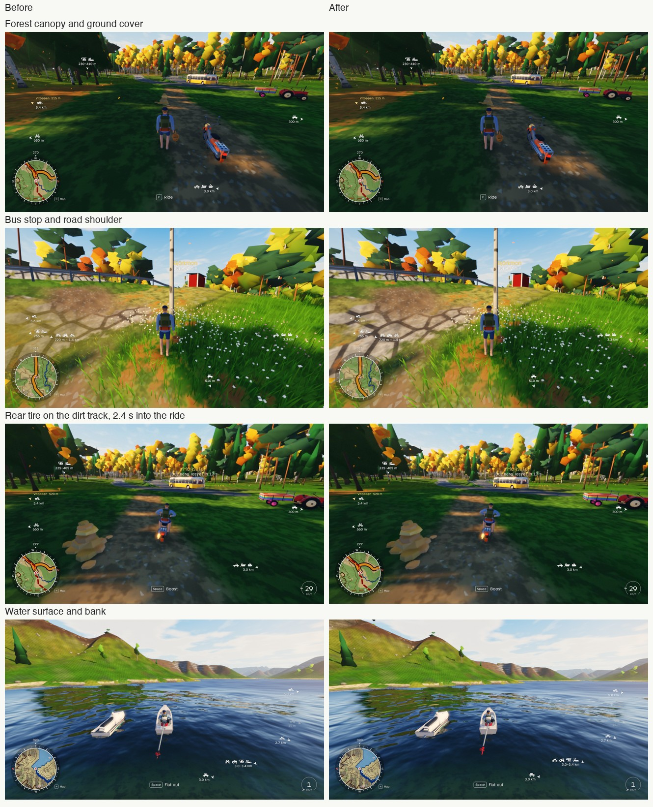

# Memory in a 10 km world

Measurements below use the same finished 4096² world, seed 123, on a 16 GiB
M2 Pro at 1280×720. Both executables loaded the same external SSD cache and
opened at the trailhead at noon. This world contains 1,169,827 forest trees.
The baseline is commit `470b8ce3` with the same memory counters added. A CPU
orogeny benchmark was running on the machine during these measurements.

## Load and steady play

The play-time sample comes from frame 7,200, about two minutes after entering
play. Peak measurements cover the entire process. GiB and MiB use powers
of two.

| Measurement | Before | After |
|---|---:|---:|
| Cache hit to play (s) | 26.05 | 17.67 |
| Peak process RSS (GiB) | 3.51 | 2.82 |
| Peak process physical footprint (GiB) | 9.75 | 5.49 |
| Play-time process RSS (MiB) | 275.9 | 221.8 |
| Play-time process physical footprint (GiB) | 5.76 | 1.68 |
| Metal buffers (MiB) | 654.3 | 446.2 |
| Metal textures (MiB) | 929.0 | 590.7 |
| All Metal allocations (GiB) | 1.58 | 1.06 |

The physical footprint fell **71%**, from 5.76 to 1.68 GiB. This exceeds
the 1 GiB combined target. Metal alone allocated about 1.06 GiB, and a
separate live heap sample measured 425 MiB. The map texture, forest records,
full-resolution terrain and water, mesh buffers, and frame arenas all count
toward the renderer total. On unified memory the process footprint already
accounts for graphics allocations. Adding Metal bytes to it would double
count them.

RSS counts physical pages currently resident. Compression and paging made
it much smaller than the charged footprint in these runs. Immediately after
activation, macOS can also retain freed generation buffers. An earlier
profile found 2.8 GiB of empty large allocator regions. The game requests
allocator reclamation at the transition to play. In a separate 1,500-frame
run the footprint still measured 4.41 GiB. Frame count and measurement
method matter when comparing a loading peak with settled play.

## What stays in play

* The 64 MiB float elevation field stays at its original address. Wheel, foot,
  glider and shadow queries reconstruct the original triangular surface normals
  at the four interpolation sites. The GPU keeps full-resolution heights and
  normals. Its road, bank and snow material channels also stay at 4096².
* Ten CPU ground-cover channels retain their native grid. Four feed wheel and
  snow physics. Six feed the animals' pasture queries. Each sample rounds to
  the nearest normalized byte. An 8×8 tile stores its minimum and the bits
  needed to represent its range. All ten channels together took 64.0 MiB
  here, compared with 160 MiB for the same bytes stored directly.
* Sparse water retains the original float elevation, wave amplitude and all
  three flow components wherever any differs from the dry default. A 64-site
  mask and population count address each stored sample. Dry sites borrow the
  physics heights. The river reaches and catalogue of water bodies remain
  available when a boat needs mooring later in the session.
* After map painting, GPU uploads, object placement and cache saving, the
  game releases its build readings, flood and per-cell drainage data, dense
  water, stored normals, erosion and sediment columns, and forest planting
  sites. The streamed physics obstacle field keeps its own colliders. World
  cache loading streams Arrow IPC directly into the reader and constructs
  each column once. The finished cache still contains the build fields used
  to paint the map and activate the world. This preserves bake compatibility.
* Five ecology and material sheets and the water current texture are capped at
  2048². The filter integrates the source area covered by each texel, including
  on odd-sized maps. The periodic sample origin and full-resolution shoreline
  geometry stay aligned with the heightfield.

## Forest work and capacity

Records are 64 bytes per tree, about 71.4 MiB for this world. A 128 m periodic
tile directory groups them into contiguous runs. The camera selects tiles by
frustum and projected crown size. The two shadow cascades select their own
tiles. Tiles crossing a nearest-image boundary test the alternative images
before dismissal. The GPU still decides visibility and topology per tree.
The wide 3.2 km shadow cascade accounts for most of the remaining work.

A classification pass counts each class, one workgroup prefixes the counts,
and a scatter pass writes contiguous class slices. Each candidate buffer
grows to fit all lanes in its active tile blocks, rounded up to 4096. One
scratch buffer serves all three views. Even if every selected tree belongs
to one class, its slice can hold all survivors. The original planting index
still determines each tree's LOD variation.

| GPU threads in one trailhead view | Before | After |
|---|---:|---:|
| Camera classification | 1,169,856 | 24,704 |
| Near shadow classification | 1,169,856 | 11,776 |
| Far shadow classification | 1,169,856 | 359,360 |
| Total including prefix and scatter | 3,509,568 | 791,872 |

This view used 47× fewer camera classification lanes, 8.9× fewer
classification lanes overall, and 4.4× fewer total dispatched threads.
Counts include partially filled 64-lane workgroups. View, shadow direction
and population change these counts.

## Visual checks

The rows below show the same cache before and after, including the road
shoulder, cast shadows, grass cover, a moving rear tire and the waterline.
The riding row uses fixed simulation time. Water animation and temporal
antialiasing can change individual pixels.



As a separate culling check, the same fixed-time ride was captured with
normal selection and with every tile offered to the GPU. Mean absolute RGB
difference was 0.59 on an 8-bit scale, with 99% of channel differences at
most 5. A scalar test also checks every intersecting tree in periodic camera
and near/far shadow views, including two-axis wraps and tiles containing
multiple workgroups. The compact water, sparse normals, cover quantization
and odd-size area filter have numerical fixtures.

## Reproducing measurements

On macOS, `MOPPE_MEMORY_REPORT=1` logs Mach process RSS and physical footprint,
Metal resident buffer and texture allocations, total device allocation, and
the camera and shadow classification lanes on screenshot. Use `detail` for
resource labels and sizes above 8 MiB. Use the same cached world, opening,
clock, drawable and frame count for each executable.

```sh
MOPPE_MEMORY_REPORT=1 MOPPE_CLOCK=12 MOPPE_OPENING=none \
MOPPE_SCREENSHOT_FRAMES=7200 MOPPE_CACHE_DIR="$cache" \
MOPPE_OROGENY=metal-multigrid /usr/bin/time -l \
  ./build/moppe.app/Contents/MacOS/moppe --windowed --inactive \
  --window-size 1280x720 --screenshot "$PWD/build/steady.png"
```

The forest comparison uses `MOPPE_FOREST_ALL_TILES=1`. The production
backend selection and standalone evolution results are documented in
[Orogeny at 10 km](orogeny-performance.md).
